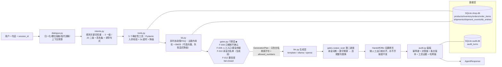

# 架构图与接口契约

## 一、一轮请求的完整链路



顺序是设计的一部分：**门禁在生成之前**。生成器收到的输入里根本没有承诺类别，
所以「白名单外承诺在输出前被拦截」不是靠提示词自觉，而是靠数据流形状（`GenerationPlan`）。

## 二、模块职责与对外接口

| 模块 | 职责 | 对外接口（签名） | 失败姿态 |
|---|---|---|---|
| `src/config.py` | 单一 `.env` 入口，零依赖 dotenv 解析，待填占位视为未配置 | `load_settings() -> Settings`、`settings()`、`reset_settings()` | 占位符不进入逻辑分支 |
| `src/schemas.py` | 全部跨模块数据结构与枚举 | `IntentPrediction/ToolResult/KBEntry/RetrievalHit/GenerationPlan/GateDecision/HandoffOffer/AgentResponse/ToolCallLog` | 类型集中，避免各处自定义 dict |
| `src/shop/db.py` | 建库、连接、内容哈希 | `build_shop_db()`、`ensure_shop_db()`、`content_hash()`、`money()` | 库缺失即重建；哈希用于复现证明 |
| `src/tools.py` | F-005 五个确定性工具 | `ToolHub.call(name, args) -> ToolResult`；`ToolHub.catalog` | `INVALID_ARGS/TIMEOUT/ERROR/NOT_FOUND`，**降级时 numbers 为空** |
| `src/kb.py` | F-006 双时态知识库与检索 | `KnowledgeBase.search/get_current/current_hits_for/set_entry_validity/stats` | 向量后端不可用 → 记 `backend_degraded` 并降级 BM25（不静默） |
| `src/intents.py` | F-002 体系与路由 | `IntentRouter.classify(text, slots)`、`detect_promise_inducement()`、`high_risk_codes`、`coverage()` | 无命中 → 兜底意图 + 压低置信度（交给 F-012） |
| `src/dialogue.py` | F-007 槽位/指代/预算 | `DialogueManager.begin_turn/end_turn/context_block`、`estimate_tokens()` | 超预算丢最早轮次并计数（`dropped_turns`） |
| `src/gates.py` | **F-008–F-012 门禁** | `GateEngine.pre_generation(...) -> (GenerationPlan, [GateDecision])`、`output_scan(plan, text) -> ScanResult`、`Ruleset.version/is_allowed/classify_text` | fail-closed：高危无条文 → 只转人工；白名单关闭 → 全部拦截 |
| `src/llm.py` | 生成层 provider 抽象（不用 LangChain） | `get_provider()`、`TemplateProvider/OllamaProvider/OpenAICompatProvider.generate(LLMRequest)` | `ProviderError` → 退回确定性模板渲染并记 `degraded` |
| `src/audit.py` | F-011 幂等 + 留痕 | `AuditLog.record()`、`existing_response()`、`trace()`、`verify_chain()`、`rows()` | 同 `request_key` 命中 → 直接返回原结论（不重判） |
| `src/agent.py` | 编排 | `Agent.handle(user_text, session_id, client_request_id) -> AgentResponse` | 人工出口补不齐 → `HandoffMissing`（拒绝发送） |
| `src/cli.py` | 启动入口 | `--ask / --demo / --audit / --rebuild / --fresh-audit` | — |
| `evals/*` | 判分、指标、抽样、kappa | `Judge.run_case/run_all`、`metrics.summarize`、`kappa.cohen_kappa` | 人工列未填 → 明确报「无法计算」，不编数 |
| `scripts/*` | 语料闸门、清洗、变异测试、延迟实测 | 各脚本 `--help` | 变异体跑完必须还原并校验 MD5 |

## 三、关键数据结构（节选，全量见 `src/schemas.py`）

```python
@dataclass
class GenerationPlan:            # 门禁 → 生成器的唯一输入
    atoms: list[UtteranceAtom]   # 每条原子句带 commit_class / 证据 id / 被批准的数字
    allowed_numbers: list[str]   # 数字溯源白名单（输出里出现却不在这里的数值 = 违规）
    must_handoff: bool
    confidence: float
    intent_code: str
    blocked_commits: list[str]   # 被白名单拒绝的承诺类别（留痕）

class CommitClass(str, Enum):    # 允许侧
    POLICY_CITE / TOOL_FACT / STATUS_INFO / PROCEDURE / HANDOFF / LIMITATION / APOLOGY
                                 # 禁止侧（红线，永不进入 plan）
    PROMISE_REFUND_OUTCOME / PROMISE_COMPENSATION / PROMISE_PRICE / PROMISE_DEADLINE
    PROMISE_STOCK / CONFIRM_ACTION / ASSUME_RESOLUTION

@dataclass
class GateDecision:
    gate: str          # "G-010-commitment-whitelist" …
    action: GateAction # PASS / EXPLAIN_ONLY / BLOCK_COMMIT / FORCE_HANDOFF / SOFT_ANSWER
                       # / REQUEST_MISSING_SLOT / FAIL_CLOSED
    reason: str        # 人类可读、直接进审计日志
    stage: str         # pre_generation（首选）| output_scan（第二道锁）
```

## 四、输入输出契约（对外只有这一个）

**输入**：`user_text: str`、`session_id: str | None`（同一 id 才有上下文与幂等重放）、
可选 `client_request_id`（客户端重试号，参与幂等键）。

**输出**：`AgentResponse`

```python
reply: str                      # 最终文本（已过第二道锁，已保证含人工出口）
intent: IntentPrediction        # code/l1/score/matched（为什么这么判，留痕）
gate_actions: list[GateAction]  # 本轮触发的门禁动作集合
decisions: list[GateDecision]   # 每个动作的 gate/reason/stage/details
handoff: HandoffOffer           # available/prompt/channel/urgent/auto_transferred/queue_hint/ticket_ref
citations: list[str]            # "[POLICY-RETURN@v2]" / "tool:query_order#<result_ref>"
tool_calls: list[ToolCallLog]   # 工具名/入参/状态/耗时/结果哈希/携带数字
confidence, must_handoff, answerable, degraded, replayed
latency_ms, token_estimate      # 延迟实测；token 为字符估算口径
atoms: list[UtteranceAtom]      # 本轮被批准的原子句（判分器复用它做承诺扫描）
```

**异常**：`HandoffMissing`（国标义务违反，宁可抛错）、`ProviderError`（外部模型不可用 → 降级）、
工具层不抛异常而是返回状态码（`INVALID_ARGS/TIMEOUT/ERROR/NOT_FOUND`）——
调用方必须显式处理状态，不允许拿到半成品答案继续生成。

## 五、数据流上的三条不变式

1. **数字不变式**：`reply` 里任何「数值 + 单位」的承诺性表述，其数字必须来自
   `ToolResult.numbers`（SQL 产出）或所引条文原文；违反即被 `output_scan` 拦掉（A9 + A2 同源机制）。
2. **出口不变式**：任何 `AgentResponse.reply` 必含人工出口字样，且 `handoff.available=True`（A3）。
3. **结论不变式**：同一 `request_key` 的结论只计算一次；重放读取审计行（A11）。

## 六、扩展点（为什么这样切）

- 换检索后端：`KnowledgeBase._scores()` 一个方法；向量后端已实现但在可选依赖里，
  加载失败会写 `backend_degraded` 事件（`stats()` 可见），不会静默变慢或假装成功。
- 换模型：`.env` 的 `LLM_PROVIDER`；生成器只被允许改写 `plan.atoms`，换模型不改门禁语义。
- 加承诺类别：`CommitClass` + `commitment_whitelist.csv` + `committal_lexicon.csv` 三处，
  并由 `tests/test_data_contracts.py` 强制「每个类别都在白名单里表态」（漏一条就红）。
- 加意图：`taxonomy.csv` 加行；`POLICY_TOPIC_BY_INTENT` 决定是否必须有条文依据，
  高危档位决定是否只解释不确认。改这两个文件会改变 `ruleset_version`，审计里可反查是哪版规则。
